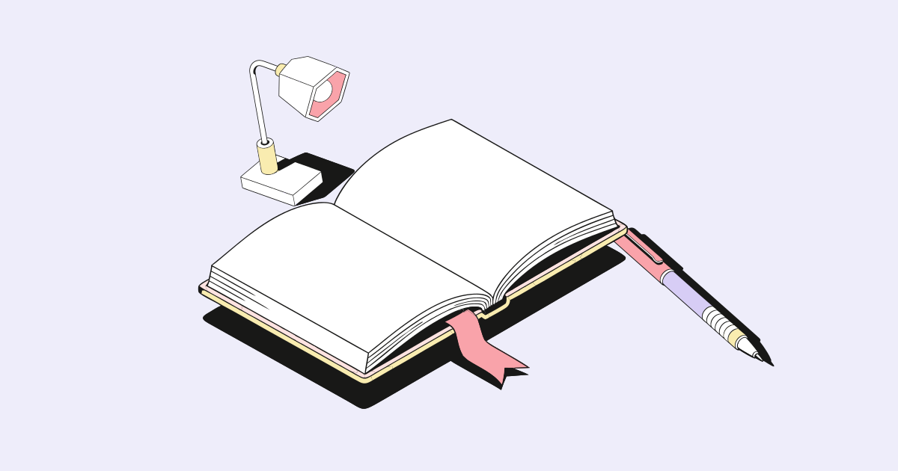
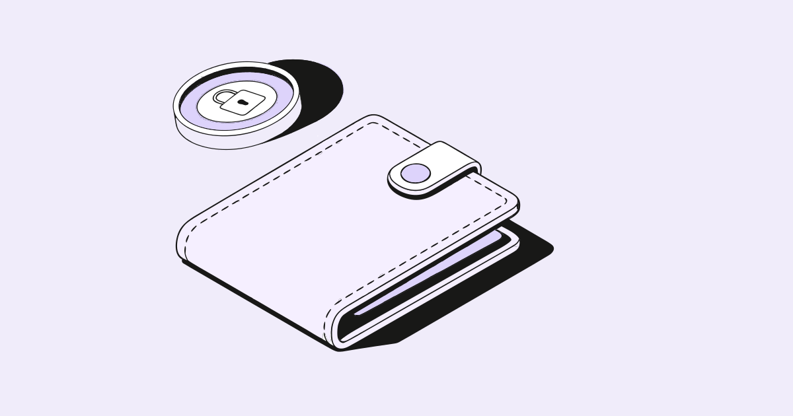

# Короткая демонстрация

1. Запустить проект по README и открыть http://127.0.0.1:5174/.
2. Ввести «Учёба и новые знания», нажать «Собрать композицию». На холсте появятся книга, лампа и ручка из исходной библиотеки.
3. Перетащить объект, потянуть угловую ручку, изменить поворот, дублировать. Во вкладке «Слои» переставить объекты за ручку или стрелками, скрыть один из них. Отмена возвращает прошлое состояние сцены.
4. Выбрать квадрат/историю, затем схему расположения. Загрузить палитру JSON `["#336699", "#88bbcc", "#ddeeff"]`. Геометрия и контуры не переписываются.
5. Скачать SVG, открыть в векторном редакторе. Внутри отдельные группы с исходными path и преобразованиями, без растровой картинки.
6. Скачать JSON-проект, обновить страницу, затем снова открыть JSON — библиотека, расположение, палитра и скрытые слои восстанавливаются.
7. Проверить второй сценарий: перечислить «Книга, Телефон, Папка, Монета, Лампа, Пазлы». Будут использованы все шесть объектов.

## Три результата

### Учёба и новые знания

### Финансовая подушка

### Работа в команде

Все примеры скачаны через интерфейс после аудита. Для нового подбора выберите «По смыслу»: браузер загрузит многоязычную модель без API-ключа. Попробуйте «Разобраться в информационном бардаке» или «Пролить свет на запутанный вопрос». Если интернет недоступен при первом запуске, используйте «По названиям». Подбор по смыслу даёт ассоциации и может нуждаться в ручной корректировке.
