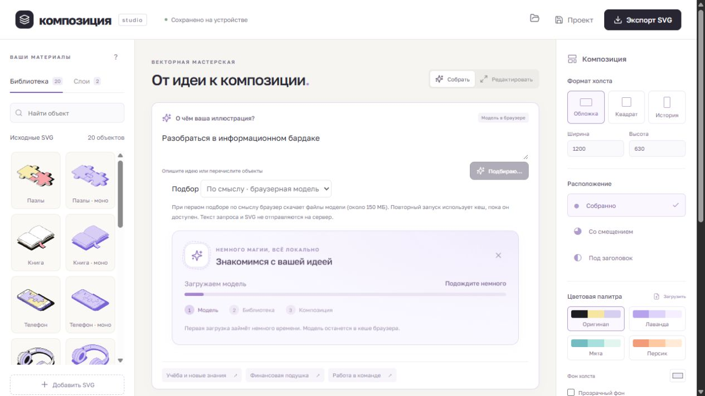

# Композиция / Snapbuild

Векторный редактор: собирает композиции из предоставленной библиотеки SVG по названиям объектов или по смыслу запроса. React, TypeScript, Vite, Transformers.js. API-ключ не нужен.

## Запуск

Требуются Node.js 24+ и npm.

```sh
npm ci
npm run dev -- --host 127.0.0.1 --port 5174
```

Открыть http://127.0.0.1:5174/ . Для собранной версии:

```sh
npm run build
npm run preview -- --host 127.0.0.1 --port 5175
```

Раздавать dist через HTTP(S); открытие index.html через file:// не поддерживается. Первая загрузка браузерной модели требует интернета и около 150 МБ трафика. Повторный запуск использует кеш, пока браузер его не удалил. Вычисления идут локально на CPU в Web Worker; запрос и SVG не отправляются на сервер. При недоступной модели можно выбрать режим «По названиям».

## Возможности

- 20 исходных SVG:10 цветных и10 монохромных вариантов. Новые иллюстрации не генерируются.
- Сборка по смыслу: многоязычные embeddings сопоставляют запрос с описаниями имеющихся объектов. Подбор возвращает до3достаточно близких объектов; неизвестная тема может не дать результата. Явные компоненты перечисляются в режиме «По названиям».
- Перемещение, пропорциональное масштабирование за4угловые ручки, поворот, дубликаты, удаление, видимость и порядок слоёв стрелками/перетаскиванием.
- 3формата и произвольные размеры100–4096,3схемы расположения, прозрачный фон.
- Загрузка палитры JSON/TXT/CSSHEX и автоматическая перекраска с сохранением исходной геометрии и нейтральных контуров.
- Экспорт SVG с исходными path, отдельными группами и уникальными ID. Полный JSON-проект для переноса, автосохранение IndexedDB, undo/redo сцены.
- Карточка загрузки модели с реальным процентом весов, этапами подготовки/подбора и отменой. Учитывается prefers-reduced-motion.

## Демонстрация

[Короткая инструкция и три SVG-примера](DEMO.md). Новые запросы для проверки: «Разобраться в информационном бардаке», «Пролить свет на запутанный вопрос», «Из маленького начинания вырастает большое дело».

## Архитектура

- `src/model.ts`: модель сцены, расположение, геометрия масштабирования, слои и выбор по названиям/тегам.
- `src/svg.ts`: DOMPurify, XML-парсинг, проверка SVG/проекта, палитры, независимые ID экземпляров и векторный экспорт. Исходный SVG хранится отдельно от преобразований.
- `src/storage.ts`: IndexedDB, проверка данных. Запись после редактирования с задержкой350мс. При ошибке восстановления автосохранение приостанавливается, чтобы не стереть старый проект.
- `src/semantic.ts`: смысловые описания объектов, нормирование названий и косинусное ранжирование.
- `src/semantic.worker.ts`: многоязычная MiniLM q8/WASM, кеш embeddings библиотеки в памяти. Worker разгружает основной поток.
- `src/semanticClient.ts`: проверка существующих ID, отмена, retry, тайм-аут5минут. Устаревший результат не заменяет изменённый проект.
- `src/ModelLoading.tsx`: доступный индикатор скачивания и подготовки.

## Происхождение SVG

Библиотека предоставлена в Figma для тестового задания Студии Очень / Снэпбилд. Штатный SVG-экспорт группы «Размер L» с ID;20групп извлечены без переписывания path. `scripts/extract_library.py` вычисляет точные границы кривых и задаёт viewBox с полем2. При повторном извлечении скрипту нужен исходный экспорт и Python svgpathtools; для обычного запуска Python не требуется. Готовые файлы: `public/library/`, манифест: `public/library.json`.

Иллюстрации принадлежат владельцу библиотеки. Репозиторий не предоставляет лицензию на их дальнейшее распространение. Полный экспорт Figma и локальная служебная информация исключены из Git.

## Ограничения

Семантическая модель ищет ассоциации, а не рассуждает как чат-LLM. Не гарантирует понимание любой метафоры: неоднозначный выбор можно исправить вручную. Например, формулировка про «трудные времена» может дать спорный набор. Отсутствующие в библиотеке объекты не дорисовываются.

SVG со встроенными CSS style-блоками, растровыми image и HTML foreignObject отклоняются. Внешние ресурсы/шрифты не загружаются. Выданная библиотека состоит из векторных контуров. Поддерживаемое соотношение сторон импорта от1:10000до10000:1.

Данные привязаны к браузеру: для переноса нужен JSON-проект. История сцены40состояний не переживает перезагрузку; изменения библиотеки/тегов вне undo. Смена схемы заново размещает экземпляры с сохранением ID и видимости. Совместной работы и серверного хранения нет.

## Проверки

```sh
npm test
npm run lint
npm run build
```

36 автотестов: исходные path всех20SVG, очистка активного содержимого и внешних ссылок, запрет растра, namespace/URL/xlink, общая перекраска, валидация проекта, защита сохранения, геометрия/слои, семантическое ранжирование, отказ на выдуманных ID, отмена/retry и тайм-аут Worker. В настоящем браузере проверены production-сборка, загрузка модели, новые метафоры, редактирование, экспорт и восстановление проекта.

## AI-инструменты

Codex использован для анализа ТЗ, реализации, извлечения исходных SVG, тестов и проверки через браузер. Новые иллюстрации нейросетью не создавались. Для подбора в приложении применяется [Xenova/paraphrase-multilingual-MiniLM-L12-v2](https://huggingface.co/Xenova/paraphrase-multilingual-MiniLM-L12-v2) через [Transformers.js](https://huggingface.co/docs/transformers.js).

## Загрузка модели


